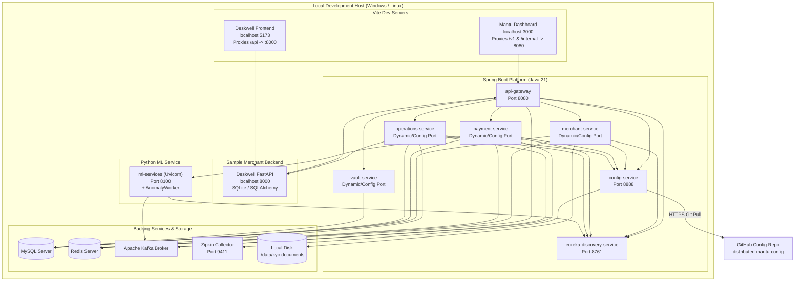

# Deployment Architecture

> **Note on Containerization:** No `Dockerfile` or `docker-compose.yml` files exist in the repository. `config-service` and `api-gateway` include `jib-maven-plugin:3.5.2` in `pom.xml` for OCI image generation during `mvn package`.
